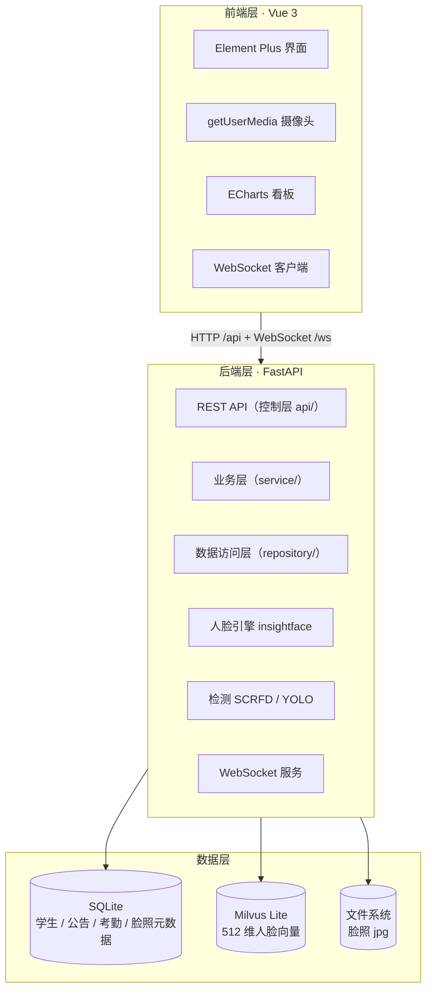

# 🎓 学生刷脸考勤系统（Student Face Attendance System）

> 一个运行在 **Windows 单机**、**前后端分离**的学生刷脸考勤系统。
> 完整打通了「摄像头采集 → 人脸检测 → 512 维向量入库 → 实时识别 → 考勤落库」的全链路。
>
> 技术重点是三件事：**严格的三层架构分层**、**SQLite / 向量库 / 文件系统三存储的一致性**、**WebSocket 实时推送**。


---

## ✨ 核心功能

| 模块 | 说明 |
|------|------|
| 👤 学生信息管理 | 单条 CRUD、搜索、分页、CSV / Excel 批量导入、级联删除 |
| 📸 人脸录入 | 摄像头拍照 → 人脸检测 → 提取 512 维向量 → SQLite + Milvus + 文件三处落库 |
| 🎯 实时刷脸识别 | SCRFD 检测 + InsightFace 识别，自动匹配底库身份 |
| 📋 考勤记录 | 识别成功自动记录考勤，同一学生 60 秒内去重 |
| 📊 数据统计看板 | 人数 / 班级 / 性别 / 专业分布、人脸覆盖率等（ECharts 可视化） |
| 📢 公告管理 | 公告 CRUD + WebSocket 实时推送 + 断线重连补拉 |
| 🔍 人脸数据审计 | 相似度矩阵 + 层次聚类，找出脏录入 / 疑似重复登记 |

---

## 🏗️ 技术架构



### 后端分层（对标 SpringBoot）

- **`api/`（Controller 层）**：REST 路由 + WebSocket 端点，只做参数校验与响应封装
- **`service/`（Service 层）**：业务编排，跨多个 repository 的复杂逻辑
- **`repository/`（Repository 层）**：SQLAlchemy 数据访问，单表/单向量操作
- **`core/`**：配置中心、DB 会话、人脸引擎、Milvus、WebSocket 连接管理、检测器
- **`models/` + `schemas/`**：ORM 模型与 Pydantic 请求/响应模型分离

人脸引擎、向量库、文件存储均通过依赖注入提供，便于替换实现与单独测试。

---

## 🧩 关键设计

### 1. 三存储一致性：SQLite 是唯一权威数据源

一次人脸录入会同时写三个地方（磁盘图片、SQLite 元数据、Milvus 向量），三者的可靠性并不对等。做法是**明确主从**：

- **SQLite 是权威数据源**，Milvus 向量和磁盘图片都是**可重新生成的派生附件**；
- 写入按固定顺序：算 embedding → 存磁盘 → 写 SQLite（分配 `face_id`）→ 写 Milvus → 回填 `face_status`；
- 删除按逆序：先删外部附件，再删权威记录；
- 任一步失败都会中断并留下可识别的中间状态（`face_status`），而不是静默产生"有元数据但检索不到"的孤儿记录。

这样即使向量库和文件系统出问题，也能凭 SQLite 重建。

### 2. 防「一人多号」：录入时跨学号查重

新录入的人脸会与底库中**其他学号**的人脸做余弦相似度比对，超过 `0.75` 判定为同一人重复登记，**拒绝录入并提示**。这拦住的是"把同一个人的脸登记到两个学号上替别人打卡"的场景。

> 该阈值目前为**经验取值，尚未做实验标定**。标定脚本：
> [`backend/scripts/calibrate_face_threshold.py`](backend/scripts/calibrate_face_threshold.py)
> —— 按目录结构放入同人 / 异人样本后运行，会输出两组相似度分布与建议阈值。

### 3. 镜像一致性：录入与识别取同一物理帧

前置摄像头预览需要水平镜像才符合直觉，但镜像会影响人脸比对结果。做法是：**前端保存原始帧不翻转，预览只用 CSS 做镜像显示**——保证「录入」和「识别」两端取到的是同一物理帧，不依赖任何一端的翻转逻辑。

### 4. 向量库选型：Milvus Lite 而非 Docker 版

目标是 Windows 单机运行。`milvus-lite` 是纯 Python 实现，直接以本地文件方式运行，**无需 Docker、无需独立服务**。代价是单进程文件锁，不能多进程并发访问。

### 5. 脸照存储路径不写死在数据库里

`backend/storage/faces/<student_id>/<filename>.jpg`，数据库只存**相对路径**。迁移存储目录时不需要改数据。

---

## 🛠️ 技术栈

**后端（Python 3.11）：**

| 组件 | 版本 | 用途 |
|------|------|------|
| FastAPI / Uvicorn | 0.136 / 0.30 | Web 框架 / ASGI 服务器 |
| SQLAlchemy | 2.0.41 | ORM + SQLite |
| pymilvus + milvus-lite | 3.0.2 / 3.2.1 | 向量库（纯 Python，Windows 无需 Docker） |
| insightface + onnxruntime | 1.0.1 / 1.28 | 人脸检测 + 识别 + 512 维 embedding |
| numpy | 1.26.4（锁 <2.0） | 数值计算（insightface/onnx 生态兼容） |
| opencv-python | 4.10.0 | 图像处理 |
| pandas / scikit-learn | 2.2.3 / 1.6.1 | 数据统计 / 聚类审计 |
| openpyxl | 3.1.5 | Excel 导入解析 |

**前端（Node + Vite）：**

| 组件 | 用途 |
|------|------|
| Vue 3.5 + Vite 6 | 框架与构建 |
| Element Plus 2.9 | UI 组件库 |
| Axios | HTTP 请求（统一 `/api` 前缀、`{code,message,data}` 信封） |
| Pinia + Vue Router | 状态管理 / 路由 |
| ECharts | 统计看板可视化 |
| 原生 WebSocket | 公告实时推送（`/ws/notices`） |

---

## 📁 目录结构

```
Student-Attendance-System/
├── backend/                     # FastAPI 后端
│   ├── main.py                  # 应用入口（uvicorn）
│   ├── requirements.txt         # 依赖清单（版本锁定）
│   ├── api/                     # 控制层（REST 路由 + WebSocket）
│   ├── service/                 # 业务层
│   ├── repository/              # 数据访问层
│   ├── models/                  # SQLAlchemy ORM 模型
│   ├── schemas/                 # Pydantic 请求/响应模型
│   ├── core/                    # 配置、DB、人脸引擎、Milvus、WS、检测器
│   ├── data/                    # 枚举数据（班级.csv / 专业.csv）
│   ├── scripts/                 # 人脸/检测功能测试脚本
│   └── storage/faces/           # 脸照存储（运行时生成，已忽略）
│
├── frontend/                    # Vue 3 前端
│   ├── src/
│   │   ├── api/                 # Axios 接口封装
│   │   ├── components/          # 摄像头采集等组件
│   │   ├── layouts/             # 页面布局
│   │   ├── router/              # Vue Router
│   │   ├── stores/              # Pinia
│   │   ├── utils/               # WebSocket 等工具
│   │   └── views/               # 各功能页面
│   ├── package.json
│   └── vite.config.js           # 开发代理（/api、/face-images、/ws → 后端 8000）
│
├── buffalo/models/buffalo_l/    # 人脸模型（体积大，需自行下载，已忽略）
├── docs/                        # 需求文档
└── .gitignore
```

---

## 🚀 快速开始

> 环境要求：**Python 3.11**（⚠️ 不要用 3.13，insightface/onnx 生态不兼容）、Node.js 18+。

### 1. 下载人脸模型（必做）

仓库**不含**人脸模型权重（共约 326 MB，超出 GitHub 限制）。需手动下载 InsightFace 的 `buffalo_l` 模型包，放到如下目录：

```
buffalo/models/buffalo_l/
├── det_10g.onnx          # SCRFD 人脸检测
├── w600k_r50.onnx         # 人脸识别（512 维 embedding）
├── 1k3d68.onnx            # 3D 人脸对齐
├── 2d106det.onnx          # 2D 关键点检测
└── genderage.onnx         # 性别年龄（可选）
```

获取方式（任选其一）：

- **方式一**：让 `insightface` 首次运行时自动下载（默认下载到 `~/.insightface/models/buffalo_l/`，再把目录复制到项目 `buffalo/models/buffalo_l/`）。
- **方式二**：从 [InsightFace 官方 release](https://github.com/deepinsight/insightface/releases) 下载 `buffalo_l.zip`，解压后放到上述目录。

> 目录约定（易踩坑）：`insightface` 要求模型在 `<root>/models/<包名>/` 下，即 `buffalo/models/buffalo_l/`，**不是** `buffalo/buffalo_l/`。放错层级会导致识别失败。

### 2. 启动后端

```bash
cd backend

# 创建虚拟环境（务必 Python 3.11）
python -m venv venv
venv\Scripts\activate          # macOS/Linux: source venv/bin/activate

pip install -r requirements.txt

# 启动（默认 127.0.0.1:8000）
python main.py
```

启动后访问 `http://127.0.0.1:8000/api/health` 可看到 SQLite / Milvus 连接状态。

### 3. 启动前端

```bash
cd frontend
npm install
npm run dev                    # 默认 127.0.0.1:5173
```

浏览器打开 `http://127.0.0.1:5173`，前端通过 Vite 代理把 `/api`、`/face-images`、`/ws` 转发到后端 8000 端口。

---

## 🔌 接口约定

- **REST**：所有 HTTP 接口前缀 `/api`，统一响应格式

  ```json
  { "code": 0, "message": "ok", "data": { } }
  ```

  `code === 0` 表示成功，非 0 表示业务错误（`message` 为错误描述）。

- **WebSocket**：公告推送端点 `/ws/notices`（无 `/api` 前缀），支持断线重连补拉。

---

## 🔬 功能测试脚本

后端 `scripts/` 提供了不依赖前端的单点验证脚本：

```bash
cd backend

venv\Scripts\python.exe scripts\test_face_engine.py          # 人脸引擎自检
venv\Scripts\python.exe scripts\test_face_data_layer.py      # 人脸数据层（SQLite + Milvus + 文件）
venv\Scripts\python.exe scripts\test_face_engine_api.py [图片路径]  # 人脸接口联调（默认 scripts/test_face.jpg，需自行放入）
venv\Scripts\python.exe scripts\test_yolo_detector.py        # 检测器自检
```

---

## 🚧 说明与限制

- 当前为**单机 localhost** 部署，未实现登录鉴权与多用户权限。
- 人脸模型约 **326 MB**，未纳入版本库，需按上文手动下载。
- 数据库（`dev.db`）、脸照（`storage/faces/`）、Milvus 数据（`milvus.db/`）均为运行时生成，已在 `.gitignore` 中排除。
- `milvus-lite` 有单进程文件锁限制，不支持多进程并发访问同一数据目录。
