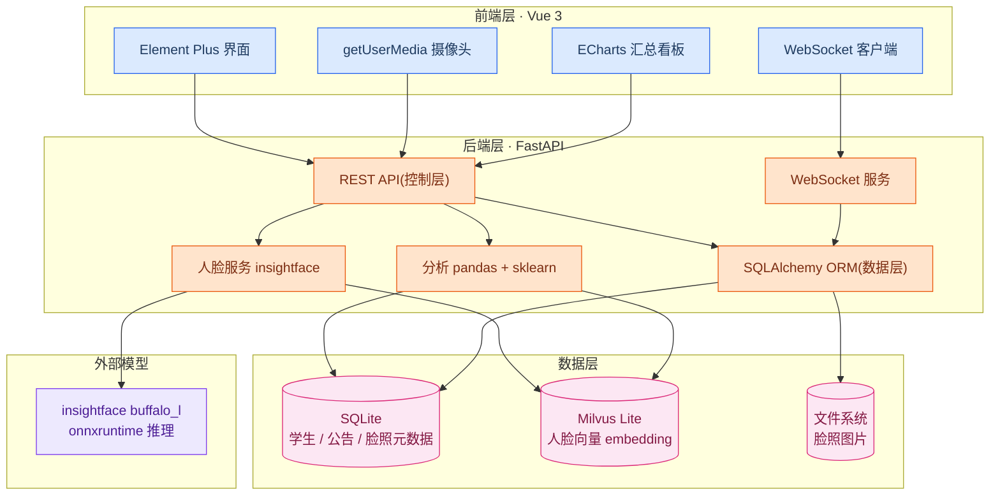
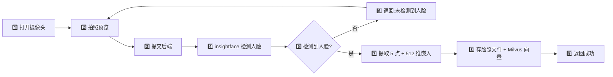
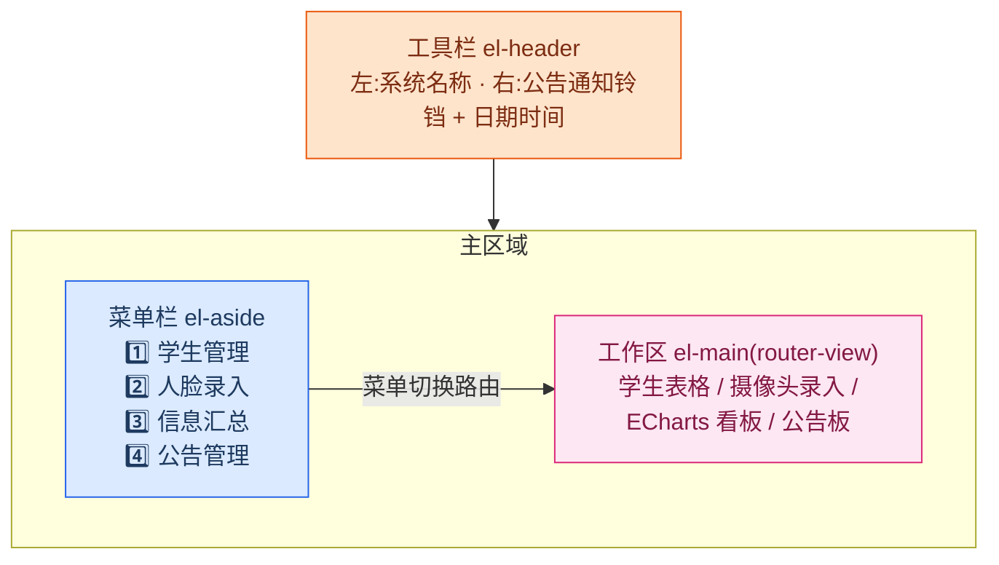
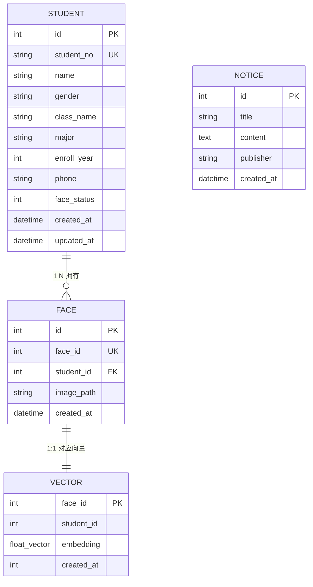
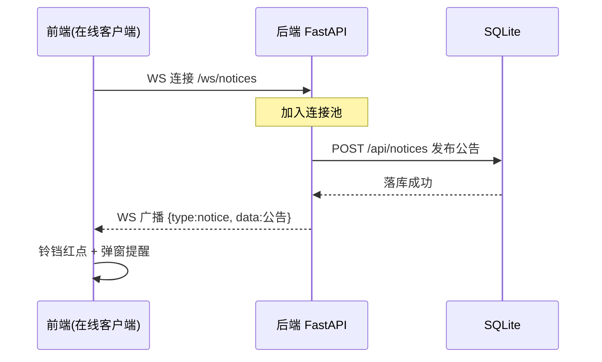

# 学生刷脸考勤系统 — 第一阶段需求文档

## 1. 项目概述

| 项 | 内容 |
|----|------|
| 项目 | 学生刷脸考勤系统 |
| 当前阶段 | 第一阶段:学生信息录入 + 人脸录入 + 学生信息汇总 |
| 后续阶段 | 第二阶段:实时检测与识别(YOLO 检测 + 人脸识别) |
| 部署形态 | 笔记本单机,前后端分离,localhost 访问 |
| 核心协议 | HTTP(REST 接口)+ WebSocket(公告实时推送) |
| 数据库 | SQLite(业务数据)+ Milvus Lite(人脸向量) |
| 后端架构 | 三层分层(Repository / Service / Controller),对标 SpringBoot |

> 第一阶段**不含实时识别**,只做数据采集与基础管理,为第二阶段扫脸考勤铺路。

## 2. 技术架构



## 3. 技术栈与版本

### 3.1 后端(Python 3.11)

| 技术 | 版本 | 用途 |
|------|------|------|
| Python | 3.11.x(锁定) | 运行时,insightface / onnxruntime 均兼容 |
| FastAPI | 0.136.x | Web 框架,HTTP + WebSocket |
| SQLAlchemy | 2.0.x | ORM 框架(对应 JPA/MyBatis) |
| pydantic | 2.x | 数据校验、DTO |
| uvicorn | 0.30+ | ASGI 服务器 |
| numpy | 1.26.x(锁 <2.0) | 向量计算、相似度矩阵 |
| pandas | 2.2.x | 汇总分析 |
| scikit-learn | 1.6.x | 聚类(脸库审计) |
| insightface | 1.0.1 | 检测 + 5 点 + 512 维嵌入 |
| onnxruntime | 1.28.0(CPU 版) | insightface 推理后端 |
| pymilvus | 2.5.x(含 milvus_lite) | 向量库 SDK,存人脸向量 |
| opencv-python | 4.10+ | 图像处理、镜像翻转 |

### 3.2 前端(Node 22)

| 技术 | 版本 | 用途 |
|------|------|------|
| Vue | 3.5.x | 框架 |
| Vite | 跟随脚手架默认 | 构建工具 |
| Element Plus | 2.14.x | UI 组件库 |
| ECharts | 5.5.x | 汇总图表 |
| axios | 1.x | HTTP 请求 |
| pinia | 2.x | 状态管理 |
| vue-router | 4.x | 路由 |
| 原生 WebSocket | — | 公告实时推送 |

### 3.3 存储设计(三层)

| 存储 | 用途 |
|------|------|
| SQLite | 业务数据:学生信息、公告、脸照元数据(路径、face_id) |
| Milvus Lite | 人脸向量(512 维 float),带标量字段关联 SQLite |
| 文件系统 | 脸照图片(按学号分目录) |

### 3.4 Milvus 集合(Collection)设计

| 字段 | 类型 | 说明 |
|------|------|------|
| face_id | int64(主键) | 脸照唯一 ID |
| student_id | int64 | 关联 SQLite 学生表 |
| embedding | float_vector(512) | 人脸向量 |
| created_at | int64 | 录入时间戳 |

索引:HNSW,度量 COSINE(余弦相似度)。

## 4. 功能需求

### 模块 1:学生信息管理(CRUD)

| 需求点 | 说明 |
|--------|------|
| 学生字段 | 学号(唯一)/ 姓名 / 性别 / 班级 / 专业 / 入学年份 / 联系方式 / 人脸录入状态 / 时间戳 |
| 增删改查 | 标准 CRUD + 搜索(姓名/学号/班级)+ 分页 |
| 批量导入 | CSV / Excel 导入(pandas) |
| 级联删除 | 删学生连脸照一起删(SQLite + Milvus + 磁盘文件) |

### 模块 2:人脸信息录入



| 需求点 | 说明 |
|--------|------|
| 摄像头采集 | 笔记本前置摄像头,实时预览 → 拍照 → 确认 |
| 镜像处理 | 前置摄像头统一翻转策略,录入与识别保持一致 |
| 人脸提取 | 检测 → 5 点 → 512 维嵌入 |
| 多脸录入 | 一个学生可存多张脸(正脸/侧脸/戴眼镜) |
| 质量把关 | 只取最大脸,无脸/模糊直接拒收并反馈 |
| 存储 | 脸照存文件系统,向量写 Milvus Lite,元数据存 SQLite |

### 模块 3:学生信息汇总

| 需求点 | 说明 |
|--------|------|
| 基础统计 | 总人数、按班级/性别/专业分布 |
| 录入覆盖率 | 已录脸 / 未录脸(第一阶段核心指标) |
| 脸照数量分布 | 几人录了多张脸 |
| 看板展示 | ECharts 图表可视化 |

### 模块 4:公告管理 + 实时推送

| 需求点 | 说明 |
|--------|------|
| 公告 CRUD | 标题 / 内容 / 发布时间 / 发布人 |
| 实时推送 | 发布后经 WebSocket 推给所有在线客户端 |
| 断线重连 | 前端自动重连 + 历史公告 HTTP 补拉 |

## 5. 机器学习实践

> ML = Machine Learning,机器学习。本项目 ML 的落地方式是**人脸嵌入聚类**(无监督),对已录入的人脸向量做分析,不需要额外的检测识别能力。

### 核心案例:人脸嵌入聚类(无监督)

从 Milvus 拉出全部向量 → 两两余弦相似度 → N×N 相似度矩阵 → 层次聚类。

| 应用场景 | 所属阶段 | 相似度表现 | 结论 |
|----------|----------|-----------|------|
| 脸库质量审计 | 第一阶段(当前) | 同一学号两张脸相似度极低(<0.6) | 脸库脏了,录错人 |
| 重复注册审计 | 第一阶段(当前) | 两个不同学号相似度极高(>0.85) | 疑似一人多号 |
| 代刷预警 | 第二阶段(考勤后) | 刷脸时实时发现跨学号高相似 | 实时拦截代刷 |

> **为什么第一阶段就能做**:录入阶段已经为每张脸提取了 embedding 向量,聚类只分析这些已存向量,不依赖第二阶段的 YOLO 检测和实时识别。代刷预警才需要第二阶段。

> 学生静态信息(姓名/学号/性别/班级)不做 ML,纯统计汇总即可,避免为 ML 而 ML。

### ML 落地到三层架构(第一阶段)

| 层 | 落点 | 职责 |
|----|------|------|
| 数据层 | `repository/face_repo.py` | 从 Milvus 拉全部向量 |
| 业务层 | `service/cluster_service.py` | numpy 相似度矩阵 + sklearn 层次聚类 |
| 控制层 | `api/audit.py` | 脸库审计接口(重复/脏数据清单) |

## 6. 项目目录结构

### 6.1 后端(FastAPI 三层架构)

```
backend/
├── main.py                # 入口,装配路由 + 中间件 + 启动事件
├── core/                  # 基础设施层
│   ├── config.py          # 配置(对应 application.yml)
│   ├── enums.py           # 枚举容器(启动时 pandas 读 CSV 填充)
│   ├── db.py              # SQLAlchemy engine / Session
│   ├── milvus.py          # Milvus Lite 客户端连接
│   └── face_engine.py     # insightface 单例(模型常驻内存)
├── data/                  # 枚举数据源(CSV)
│   ├── 班级.csv            # 班级枚举
│   └── 专业.csv            # 专业枚举
├── models/                # ORM 实体(对应 @Entity)
│   ├── student.py
│   ├── face.py
│   └── notice.py
├── schemas/               # DTO(对应 DTO/VO)
│   ├── student.py
│   ├── face.py
│   └── notice.py
├── repository/            # 数据层(对应 @Repository)
│   ├── student_repo.py
│   ├── face_repo.py       # 含从 Milvus 拉向量的查询
│   └── notice_repo.py
├── service/               # 业务层(对应 @Service)
│   ├── student_service.py
│   ├── face_service.py
│   ├── stats_service.py
│   ├── cluster_service.py # 人脸嵌入聚类(ML 脸库审计)
│   └── notice_service.py
└── api/                   # 控制层(对应 @RestController)
    ├── deps.py            # 依赖注入(对应 @Autowired)
    ├── students.py
    ├── faces.py
    ├── stats.py
    ├── audit.py           # 脸库审计接口(ML 结果输出)
    └── notices.py         # 含 WebSocket 端点
```

三层职责边界:

- **api/ 控制层**:接请求、校验参数、调 Service、返回响应,不碰业务
- **service/ 业务层**:业务逻辑、编排 Repository、事务边界(含 ML 聚类)
- **repository/ 数据层**:封装 SQLAlchemy 增删改查,不碰业务

### 6.2 前端(Vue 3 + Vite)

```
frontend/
├── index.html
├── package.json
├── vite.config.js         # 配置 dev 代理到后端(解决跨域)
├── src/
│   ├── main.js            # 入口,挂载 Element Plus / pinia / router
│   ├── App.vue
│   ├── api/               # 接口封装(axios)
│   │   ├── request.js     # axios 实例 + 拦截器
│   │   ├── student.js
│   │   ├── face.js
│   │   ├── stats.js
│   │   ├── audit.js       # 脸库审计接口
│   │   └── notice.js
│   ├── views/             # 页面级组件
│   │   ├── StudentList.vue      # 学生管理
│   │   ├── FaceEnroll.vue       # 人脸录入
│   │   ├── StatsDashboard.vue   # 汇总看板
│   │   ├── FaceAudit.vue        # 脸库审计(ML 结果展示)
│   │   └── NoticeBoard.vue      # 公告板
│   ├── components/        # 通用组件
│   │   └── CameraCapture.vue    # 摄像头采集(复用)
│   ├── stores/            # pinia 状态
│   │   └── notice.js      # 公告状态(含 WS 推送数据)
│   ├── utils/             # 工具
│   │   └── websocket.js   # WebSocket 封装(自动重连)
│   └── router/
│       └── index.js       # 路由表
```

### 6.3 前端整体布局

经典后台管理布局:顶部工具栏 + 左侧菜单栏 + 右侧工作区。



区域映射:

| 区域 | Element Plus 组件 | 内容 |
|------|-------------------|------|
| 工具栏 | `el-header` | 左:系统名称;右:公告通知铃铛(`el-badge` 红点)+ 日期时间 |
| 菜单栏 | `el-aside` + `el-menu` | 四个功能入口,点击切换路由 |
| 工作区 | `el-main` + `router-view` | 按菜单路由切换四种页面 |

菜单与路由对应:

| 菜单项 | 路由 | 页面组件 | 内容 |
|--------|------|----------|------|
| 学生管理 | /students | StudentList.vue | 表格 CRUD + 搜索 + 分页 |
| 人脸录入 | /faces | FaceEnroll.vue | 摄像头预览 + 拍照提交 |
| 信息汇总 | /stats | StatsDashboard.vue | ECharts 看板 |
| 公告管理 | /notices | NoticeBoard.vue | 公告列表 + 发布 |

公告实时推送落在工具栏:WebSocket 收到公告 → 铃铛亮红点 + `el-notification` 弹窗提醒。

## 7. 关键落地难点

| # | 难点 | 规避方案 |
|---|------|---------|
| 1 | insightface 模型下载(国内网络易失败) | 手动下载 `buffalo_l` 放到 `~/.insightface/models/buffalo_l/` |
| 2 | numpy 2.x 兼容冲突 | 锁 `numpy<2.0`,装 1.26.x |
| 3 | 前置摄像头镜像 | 前端 canvas 统一翻转策略,录入与识别一致 |
| 4 | 脸照存库膨胀 | 脸照存文件系统,SQLite 只存元数据 |
| 5 | 级联删除三处同步 | 删学生需同步清 SQLite + Milvus 向量 + 磁盘脸照文件 |
| 6 | 多脸/无脸/侧脸误存 | 只取最大脸,无脸拒收并提示 |
| 7 | 模型重复加载慢 | 应用启动时单例加载,常驻内存 |
| 8 | 光照/距离导致质量差 | 录入实时质量提示,不合格不给提交 |

## 8. 已定决策

| 决策项 | 结论 |
|--------|------|
| 人脸库 | insightface(弃用 face_recognition) |
| 向量存储 | Milvus Lite(弃用 SQLite BLOB) |
| 数据访问 | SQLAlchemy 2.0 + Repository/Service/Controller 三层 |
| ML 实践 | 人脸嵌入聚类(脸库审计 + 代刷预警) |
| 嵌入维度 | 512 维(ArcFace) |
| 摄像头 | 笔记本单点录入,localhost 访问 |
| 删除策略 | 级联删除(SQLite + Milvus + 文件) |
| 学生静态信息 | 只做统计,不做 ML |

## 9. 数据模型设计

### 9.1 实体关系图(ER 图)



### 9.2 SQLite 表结构(字段级)

#### students 学生表

| 字段 | 类型 | 约束 | 说明 |
|------|------|------|------|
| id | INTEGER | PK,自增 | 主键 |
| student_no | VARCHAR(20) | UK,NOT NULL | 学号(唯一) |
| name | VARCHAR(50) | NOT NULL | 姓名 |
| gender | VARCHAR(10) | — | 性别(男/女) |
| class_name | VARCHAR(50) | 枚举约束 | 班级(枚举值,下拉选择) |
| major | VARCHAR(50) | 枚举约束 | 专业(枚举值,下拉选择) |
| enroll_year | INTEGER | — | 入学年份 |
| phone | VARCHAR(20) | — | 联系方式 |
| face_status | INTEGER | 默认 0 | 人脸录入状态(0 未录 / 1 已录) |
| created_at | DATETIME | — | 创建时间 |
| updated_at | DATETIME | — | 更新时间 |

> `face_status` 是冗余字段,用于快速统计"已录/未录",不必 join faces 表。

> **专业/班级采用程序枚举类约束输入**(下拉选择,不自由输入)。机制:
> 1. `core/enums.py` 定义枚举容器(动态列表/集合)。
> 2. 程序**启动时**用 pandas 读取两个 CSV,填充枚举值:
>    - `data/班级.csv` → 班级枚举
>    - `data/专业.csv` → 专业枚举
> 3. 前端下拉选项、后端输入校验都从枚举容器取值。
> 4. **修改枚举 = 改对应 CSV + 重启程序**,无需改代码。

#### faces 脸照表

| 字段 | 类型 | 约束 | 说明 |
|------|------|------|------|
| id | INTEGER | PK,自增 | 主键 |
| face_id | INTEGER | UK | 桥接 Milvus 的 face_id |
| student_id | INTEGER | FK → students.id,ON DELETE CASCADE | 所属学生 |
| image_path | VARCHAR(255) | — | 脸照文件路径 |
| created_at | DATETIME | — | 录入时间 |

#### notices 公告表

| 字段 | 类型 | 约束 | 说明 |
|------|------|------|------|
| id | INTEGER | PK,自增 | 主键 |
| title | VARCHAR(100) | NOT NULL | 标题 |
| content | TEXT | — | 内容 |
| publisher | VARCHAR(50) | — | 发布人 |
| created_at | DATETIME | — | 发布时间 |

### 9.3 Milvus 集合(face_vectors)

| 字段 | 类型 | 说明 |
|------|------|------|
| face_id | INT64(主键) | 对应 SQLite faces.face_id |
| student_id | INT64 | 对应 SQLite students.id |
| embedding | FLOAT_VECTOR(512) | 人脸向量(ArcFace) |
| created_at | INT64 | 录入时间戳 |

索引:HNSW,度量 COSINE(余弦相似度)。

### 9.4 关联关系与删除链

- **桥接字段**:`face_id` 是 SQLite `faces` 表与 Milvus `face_vectors` 集合之间的一一对应桥梁。
- **删除链**(三处同步,对应第 7 节难点 #5):

```
删学生
 ├─ SQLite faces 记录:外键 ON DELETE CASCADE 自动删
 ├─ Milvus 向量:按 face_id 手动删
 └─ 磁盘脸照文件:按 image_path 手动删
```

## 10. 接口说明

> 统一约定:HTTP 前缀 `/api`;响应格式 `{"code": 0, "message": "ok", "data": {...}}`,`code=0` 成功,非 0 失败。

### 10.1 HTTP 接口(RESTful)

> 统一响应包裹:`{"code": 0, "message": "ok", "data": {...}}`。下面各接口只列 `data` 的具体结构。

#### 学生管理

| 方法 | 路径 | 说明 |
|------|------|------|
| GET | /api/students | 分页查询,支持姓名/学号/班级搜索 |
| GET | /api/students/{id} | 查询单个学生 |
| POST | /api/students | 新增学生 |
| PUT | /api/students/{id} | 更新学生 |
| DELETE | /api/students/{id} | 删除学生(级联删脸照) |
| POST | /api/students/import | 批量导入 CSV/Excel |

新增/更新请求体:

```json
{
  "student_no": "202301001",
  "name": "张三",
  "gender": "男",
  "class_name": "智造本2023-1班",
  "major": "计算机科学与技术",
  "enroll_year": 2023,
  "phone": "13800000000"
}
```

查询返回(学生对象,含系统字段):

```json
{
  "id": 1,
  "student_no": "202301001",
  "name": "张三",
  "gender": "男",
  "class_name": "智造本2023-1班",
  "major": "计算机科学与技术",
  "enroll_year": 2023,
  "phone": "13800000000",
  "face_status": 1,
  "created_at": "2026-09-17 16:00:00",
  "updated_at": "2026-09-17 16:00:00"
}
```

分页查询 `data`:

```json
{
  "total": 100,
  "page": 1,
  "page_size": 20,
  "items": ["学生对象数组"]
}
```

#### 枚举

| 方法 | 路径 | 说明 |
|------|------|------|
| GET | /api/enums | 返回专业/班级枚举(前端下拉选项) |

`data`:

```json
{
  "classes": ["智造本2023-1班", "智造本2023-2班"],
  "majors": ["计算机科学与技术", "软件工程"]
}
```

#### 人脸录入

| 方法 | 路径 | 说明 |
|------|------|------|
| POST | /api/students/{id}/faces | 上传脸照(multipart 图片),返回检测结果 |
| GET | /api/students/{id}/faces | 查询学生脸照列表 |
| DELETE | /api/faces/{face_id} | 删除单张脸照 |

上传成功 `data`:

```json
{
  "detected": true,
  "face_id": 1,
  "image_path": "/faces/202301001/xxx.jpg"
}
```

上传失败 `data`:

```json
{
  "detected": false,
  "reason": "未检测到人脸"
}
```

脸照对象(列表查询返回):

```json
{
  "id": 1,
  "face_id": 1,
  "student_id": 1,
  "image_path": "/faces/202301001/xxx.jpg",
  "created_at": "2026-09-17 16:00:00"
}
```

#### 汇总统计

| 方法 | 路径 | 说明 |
|------|------|------|
| GET | /api/stats/summary | 总人数、班级/性别/专业分布 |
| GET | /api/stats/face-coverage | 人脸录入覆盖率(已录/未录) |
| GET | /api/stats/face-count | 脸照数量分布 |

`GET /api/stats/summary` 的 `data`:

```json
{
  "total_students": 100,
  "by_class": {"智造本2023-1班": 50, "智造本2023-2班": 50},
  "by_gender": {"男": 60, "女": 40},
  "by_major": {"计算机科学与技术": 80, "软件工程": 20}
}
```

`GET /api/stats/face-coverage` 的 `data`:

```json
{
  "enrolled": 80,
  "not_enrolled": 20,
  "coverage_rate": 0.8
}
```

`GET /api/stats/face-count` 的 `data`:

```json
{
  "zero_face": 20,
  "one_face": 60,
  "multiple_faces": 20
}
```

#### 脸库审计(ML)

| 方法 | 路径 | 说明 |
|------|------|------|
| GET | /api/audit/duplicates | 疑似重复/脏数据清单(聚类结果) |

`data`:

```json
{
  "duplicates": [
    {
      "student_a": {"id": 1, "name": "张三", "student_no": "202301001"},
      "student_b": {"id": 2, "name": "李四", "student_no": "202301002"},
      "similarity": 0.92
    }
  ]
}
```

#### 公告管理

| 方法 | 路径 | 说明 |
|------|------|------|
| GET | /api/notices | 公告列表(分页) |
| GET | /api/notices/{id} | 公告详情 |
| POST | /api/notices | 发布公告(触发 WS 推送) |
| PUT | /api/notices/{id} | 更新公告 |
| DELETE | /api/notices/{id} | 删除公告 |

公告请求体(新增/更新):

```json
{
  "title": "标题",
  "content": "内容",
  "publisher": "发布人"
}
```

公告对象(查询返回):

```json
{
  "id": 1,
  "title": "标题",
  "content": "内容",
  "publisher": "发布人",
  "created_at": "2026-09-17 16:00:00"
}
```

### 10.2 WebSocket 接口

#### 端点

`WS /ws/notices` — 公告实时推送通道。

#### 消息格式(JSON)

服务端 → 客户端(推送公告):

```json
{"type": "notice", "data": {"id": 1, "title": "标题", "content": "内容", "publisher": "发布人", "created_at": "2026-09-17 16:00:00"}}
```

心跳:

```json
{"type": "ping"}
```

客户端回复 `{"type": "pong"}` 维持连接。

#### 推送流程



> 断线重连:前端自动重连,重连后通过 `GET /api/notices` 补拉错过的公告。

## 11. 阶段规划

| 阶段 | 内容 |
|------|------|
| 第一阶段(当前) | 学生 CRUD + 人脸录入 + 汇总 + 公告推送 + 脸库质量审计 |
| 第二阶段(后续) | YOLO 实时检测 + 人脸识别比对 + 考勤记录 + 代刷预警 |
